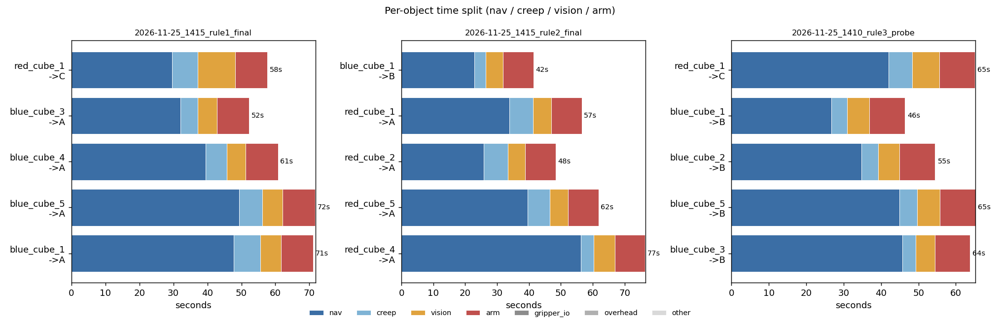
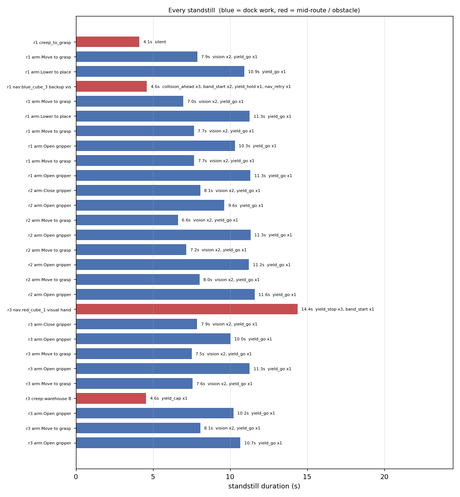
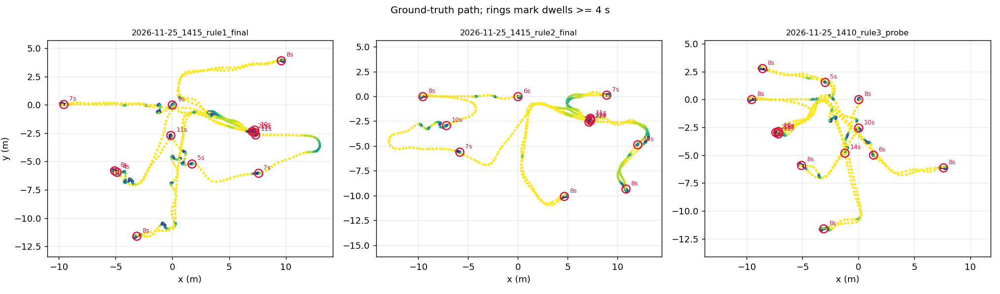
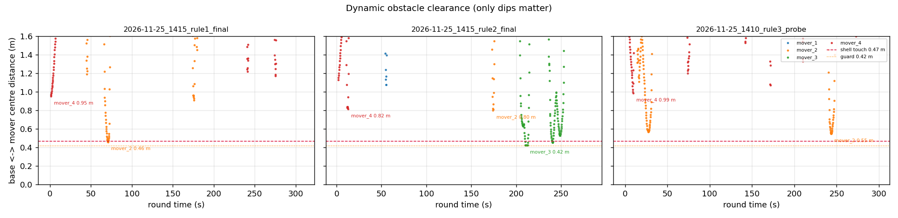

# 三种映射规则下的导航 / 避障基线实测（2026-11-25，GitHub 11-23 版代码）

代码版本：`MFWTW/intelligence_algorithm` `main@09e2470`（"Add a lane-park experiment that forces the
contact guard to engage"，2026-11-23 20:48 +0800），工作区与上游 `diff -rq` 零差异。
构建：`colcon build --symlink-install` → 7 包 22.5 s，exit 0。

跑法：`COLLISION_PROBE=1 bash tools/run_round.sh <rule> runs/2026-11-25_1113_rule<N>`，
逐轮改 `src/yzbot/mybot/config/task_parser.yaml` 的 `mapping_rule`，按 `启动流程.md`
按开始按钮，等 `State -> COMPLETED`。三轮同一题面（seed 997542，"衣柜 5 件衣物"题），
移动障碍 `MYBOT_MOVING_OBSTACLES=true`（默认）。

| 轮次 | 规则 | 结果 | 物块合计 | 导航 | 蠕行 | 视觉调整 | 拿放(臂) | 墙钟 |
|---|---|---:|---:|---:|---:|---:|---:|---:|
| `runs/2026-11-25_1113_rule1` | 1 | **COMPLETED 5/5** | 276.7 s | 167.7 (60.6%) | 30.0 | 30.9 | 47.6 | 239 s |
| `runs/2026-11-25_1113_rule2` | 2 | **COMPLETED 5/5** | 311.8 s | 187.1 (60.0%) | 47.3 | 29.4 | 47.6 | 259 s |
| `runs/2026-11-25_1113_rule3` | 3 | FAILED 0/5 (28.3 s) | — | — | — | — | — | 28 s |
| `runs/2026-11-25_1130_rule3` | 3 | FAILED 0/5 (76.8 s) | — | — | — | — | — | 77 s |
| `runs/2026-11-25_1130_rule3_attempt3` | 3 | FAILED 0/5 (42.3 s) | — | — | — | — | — | 42 s |
| `runs/2026-11-25_1135_rule3_staleodomfix` | 3 | 3/5（只打 odom 补丁） | 215.2 | 141.8 | 13.7 | 24.9 | 33.2 | 205 s |
| `runs/2026-11-25_1143_rule3_slimshell` | 3 | **COMPLETED 5/5**（两个补丁） | 260.5 | 161.5 (62.0%) | 20.4 | 30.6 | 47.5 | 240 s |

> 说明：`导航` 是 Nav2 的 `navigate to warehouse` 腿，`蠕行` 是泊位附近的低速接近段
> （`creep`），`视觉调整` 是物块对准（`vision`），`拿放` 是机械臂各步合计。四条腿重叠
> 时物块合计会大于墙钟。

---

## 1. 每物块分段耗时

### rule1（COMPLETED 5/5）

| 物块 | 仓库 | 合计 | 导航 | 蠕行 | 视觉 | 拿放(臂) |
|---|---|---:|---:|---:|---:|---:|
| red_cube_1 | C | 54.9 | 30.8 | 6.4 | 8.0 | 9.5 |
| red_cube_5 | C | 46.0 | 24.9 | 5.6 | 5.9 | 9.5 |
| blue_cube_3 | A | 43.2 | 23.9 | 4.1 | 5.7 | 9.5 |
| blue_cube_4 | A | 63.0 | 40.2 | 7.4 | 5.8 | 9.5 |
| blue_cube_5 | A | 69.6 | 47.9 | 6.5 | 5.5 | 9.5 |
| **合计** | | **276.7** | **167.7** | **30.0** | **30.9** | **47.6** |

### rule2（COMPLETED 5/5）

| 物块 | 仓库 | 合计 | 导航 | 蠕行 | 视觉 | 拿放(臂) |
|---|---|---:|---:|---:|---:|---:|
| blue_cube_1 | B | 44.2 | 25.0 | 3.9 | 5.6 | 9.5 |
| blue_cube_2 | B | 63.4 | 43.6 | 4.1 | 6.2 | 9.5 |
| red_cube_1 | A | 56.0 | 33.8 | 6.5 | 6.1 | 9.5 |
| red_cube_2 | A | 50.0 | 27.0 | 7.7 | 5.7 | 9.5 |
| red_cube_5 | A | 98.2 | 57.8 | **25.1** | 5.8 | 9.5 |
| **合计** | | **311.8** | **187.1** | **47.3** | **29.4** | **47.6** |

两条值得注意的腿：

* rule2 `red_cube_5` 合计 98.2 s，其中蠕行 25.1 s——被分到仓库 A 的这个红块取件点在
  `(9.56, 3.99)`，从上一个泊位绕到 A 的接近段很长，是全场最慢的一条腿。
* rule1 `blue_cube_5` 导航 47.9 s，比同仓库的 `blue_cube_4`（40.2 s）多 7.7 s，
  多出来的部分是绕开巡逻箱后的重新规划。

图：`analysis/fig1_per_object.png`（每物块四段堆叠；第三栏是 §4.6 打了 odom 补丁后的
rule3 验证轮，只跑了 3 单）。



---

## 2. 小车为什么在某个位置停很久

工具 `tools/dwell_report.py`：用 `events.jsonl` 里 `link_states/base_footprint` 的
Gazebo 真值找"位移 < 0.08 m 且持续 ≥ 2.5 s"的窗口，再把同时段日志按类别计数，
得每段停留的**主导原因**。全表 `analysis/dwells.csv`。

| 轮次 | 停留段数 | 停留总时长 | 占整轮 |
|---|---:|---:|---:|
| rule1 | 9 | 77.9 s | 32.6% (77.9/239) |
| rule2 | 9 | 84.7 s | 32.7% (84.7/259) |

### 2.1 结论：长停留只有两类，一类正常一类是真缺陷

**（A）泊位作业——正常。** 18 段停留里有 16 段发生在泊位（`phase = arm:*`），
只包含 `vision`（物块对准）和 `yield_go`（等巡逻箱过去后一次性放行）两类原因：

| 典型段 | 位置 | 时长 | 原因 |
|---|---|---:|---|
| `arm:Move to grasp` | 取件点 | 7.3–8.2 s | vision ×2（俯视相机对准物块中心） |
| `arm:Lower to place` | 仓库泊位 | 10.7 s | 下降放块 + yield_go ×1 |
| `arm:Open gripper` | 仓库泊位 | 9.5–11.2 s | 松爪 + 撤退 + yield_go ×1 |

这些时间是机械臂节拍本身（`config/profiles/executor_fast.yaml`），不是导航卡顿。

**（B）让行动作里的"退让被拒"——缺陷。** 真正由动态障碍触发的停留只有两段，
而且两段的日志指纹**一模一样**：

| 轮次 | 位置 | 时长 | 日志指纹 |
|---|---|---:|---|
| rule1 | `(-2.06, -5.93)` | 5.8 s | `band_start ×2, stale_odom ×2, nav_retry ×1, hold_still ×1` |
| rule2 | `(-2.62, +1.54)` | 12.3 s | `yield_stop ×2, band_start ×2, stale_odom ×2, nav_retry ×1` |

展开 rule1 那 5.8 s 的原始日志：

```
Yield stop: waiting for the mover to clear the corridor near (-2.06, -5.93)
warehouse C: the start pose is inside an inscribed band; retreating before asking for a plan.
warehouse C: leaving the band at the start pose: guarded retreat measured 0.00 m; stop: stale odometry.
warehouse C: resuming the original route after the sidestep was abandoned.
warehouse C: holding still for a moving obstacle.
```

即：车停在**膨胀层内切带（inscribed band）里**，代码知道要退出来再规划
（`_ensure_start_pose_outside_band`），但退让的第一步要取 `odom` 位姿，
`_recovery_stamp_fresh()` 判定时戳"太新"而拒绝 → 退让距离 0.00 m → 放弃侧移 →
退回原路线干等。**每次白等 6–12 s，rule1 一个轮次就发生了 9 次**
（`stale odometry` 计数 9，rule2 3 次）。

根因在 `src/yzbot/mybot/scripts/fixed_joint_pick_place.py:5060`：

```python
return -0.05 <= age <= max_age
```

`age` 是 `now - stamp`。odom 时间戳只要比 `now` 新 50 ms 以上就被判为"不可信"，
而 Gazebo 的 odom 与系统时钟本来就存在毫秒级不对齐，实测出现过 `-0.276 s` 的样本。
**未来时戳只可能来自时钟/仿真时间的轻微前置，不是坏数据**，把它当 stale 是误判。

图：`analysis/fig2_dwell.png`（每根柱=一段停留，蓝=泊位作业、红=途中停等，柱右标主导原因），`analysis/fig4_paths.png`
（真值轨迹 + ≥4 s 停留用红圈标出，能直接看到停留点都在泊位或走廊口）。





---

## 3. 动态障碍物：有没有"擦着车过去"或被推走

工具 `tools/contact_analysis.py`：用 Gazebo 真值做 SAT 分离轴测距，两种壳径
— `hull`（真实碰撞体：底盘 0.32 m 见方，与 mover 的 0.22 m 见方箱）和
`policy`（让行策略自己假设的安全壳，`base_half_length 0.25` 等）。

| 轮次 | 最近 hull 间隙 | 最近 policy 间隙 | 物理接触 | 停车时被推走 |
|---|---:|---:|---|---|
| rule1 | **+0.305 m**（mover_2 @35.5 s） | +0.195 m | 无 | 无 |
| rule2 | **+0.380 m**（mover_4 @84.2 s） | +0.212 m | 无 | 无 |

基地中心到 mover 中心的最小距离：rule1 **0.68 m**、rule2 **0.75 m**。
mover 箱半宽 0.11 m + 底盘半宽 0.16 m + 0.10 m 缓冲 ≈ 0.37 m 才算"贴脸"，
所以两轮都**没有出现擦着车过去**，也没有出现"停着被巡逻箱顶着走"。

为什么能这么稳：`Yield` 策略在预测到交汇时会先 `cap` 限速再 `stop`，两轮里
`decision=go` 31 / 30 次、`stop` 2 / 3 次，且 `collision_monitor` 全程没有触发
`Collision Ahead - Exiting`（0 次）——说明减速让行在撞上之前就把局面化解了。

唯一需要盯着的是 **policy 间隙只剩 0.195 m**：真实碰撞体还有 0.305 m，但策略层
自己认为只剩 0.2 m 时它就会开始 `stop`，这解释了那两段 6–12 s 的停等——**让行偏保守**，
和 2.1(B) 的退让被拒叠加，就成了可见的停顿。

图：`analysis/fig3_movers.png`（每条曲线是某个 mover 与车的中心距，红线 0.47 m 是
"壳相碰"阈值，橙点线 0.42 m 是 contact guard 阈值；曲线的最低点就是最接近的时刻）。



---

## 4. rule3 为什么整轮报废（三次尝试，两种机制）

rule 3 的映射是"红→C、蓝→C"，**三次尝试全部死在第一单 `red_cube_1 -> C`**，
说明这不是偶发抖动，而是路线与让行逻辑的固定冲突：

| 尝试 | 目录 | 失败时长 | 终点状态 | 关键日志 |
|---|---|---:|---|---|
| 1 | `runs/2026-11-25_1113_rule3` | 28.3 s | FAILED 0/5 | yield arc → band → `guarded retreat 0.00 m; stop: stale odometry` |
| 2 | `runs/2026-11-25_1130_rule3` | 76.8 s | FAILED 0/5 | `status=6`，74 次 planner 失败 + Yield cap 抖动 |
| 3 | `runs/2026-11-25_1130_rule3_attempt3` | 42.3 s | FAILED 0/5 | 同第 1 次：band → `guarded retreat 0.00 m; stop: stale odometry` |

两次（1、3）路径相同、一次（2）是它的下游后果，下面分开看：

### 4.1 第一次（`runs/2026-11-25_1113_rule3`，28 s，0/5）

```
Yield arc (predict-arc) near ... world=0.29
warehouse C yield arc: the start pose is inside an inscribed band; retreating before asking for a plan.
warehouse C yield arc: leaving the band at the start pose: guarded retreat measured 0.00 m; stop: stale odometry.
warehouse C: resuming the original route after the sidestep was abandoned.
warehouse C: holding still for a moving obstacle.
TIMING nav:warehouse C 0.111
Pick-and-place stopped at step: navigate to warehouse.
UNSAFE_OBJECT_STATE:NAV_TO_ZONE:navigate to warehouse:FAILED:CUBE_ATTACHED
```

和 2.1(B) 是**同一个 bug**，只是这次退让失败后没有再成功：侧移放弃 → 回原路线 →
`hold` 立刻返回 → 这条腿被判失败。载货状态下的失败按设计**禁止自动重试**
（"Robot or attachment state is unsafe/unknown…"），整轮直接 FAILED。

> `CUBE_ATTACHED` 只是"失败时手里有块"的标记，不是夹取失败。

### 4.2 第二次（`runs/2026-11-25_1130_rule3`，77 s，0/5）

换了一套机制：车在 `(-3.27, -6.75)` 被卡住 55 s。

| 现象 | 计数（该腿 55 s 内） |
|---|---:|
| `GridBased: failed to create plan` | 74 |
| `detected collision ahead` | 9 |
| `Running backup` / `Running spin` | 12 / 11 |
| `Yield cap: 0.60→0.30 / 0.30→0.60` 翻转 | 46 |
| 目标被 cancel 后重发 | 6 |

日志里车在原地反复 `Begin navigating from current location (-3.27,-6.75) to (0.02,-2.70)`，
每 1–2 s 被 cancel 一次（`Yield cap` 抖动 → 重新下发目标），最后
`Behavior Tree tick rate 20.00 was exceeded!` → `Aborting handle.` → `Goal failed` →
`Navigation to warehouse C failed; status=6` → `warehouse C: no verified recovery for
unclassified failure.` → 整轮 FAILED。

**几何原因**（实测 `src/yzbot/bot_navigation/maps/room_from_world.pgm`，res 0.05）：

| 位置 | 到最近占据格 |
|---|---:|
| 卡死点 `(-3.27, -6.75)` | **0.40 m** |
| 另一处历史卡点 `(-5.01, -1.49)` | 0.30 m |
| 仓库 C 泊位 `(0.02, -2.70)` | 空闲 |
| 仓库 A 泊位 `(7.30, -2.44)` | 1.15 m |

载货时 `Nav2 geometry confirmed for loaded transport: local radius=0.35 m,
global radius=0.45 m`（空载 0.32/0.42），`global_radius_margin_m: 0.10`
→ 载货 inscribed 半径 0.45 m。**0.40 m < 0.45 m**，起点格落在 lethal/inscribed 带内，
NavFn 拒绝出图（74 次），`backup`/`spin` 又被 `collision_monitor` 拒（"Collision Ahead"），
于是原地死锁，直到 BT 超限 abort。

配置里的逃生钩子没救回来：`fixed_joint_pick_place.yaml:164 stuck_relax_global_radius: true`
会先放松全局半径再规划，但 0.40 m 的缺口对 0.35 m 的车体本身就已经很紧，
放松一次仍不够。

---

### 4.6 验证轮：补上 odom 补丁之后（`runs/2026-11-25_1135_rule3_staleodomfix`）

补丁见 `analysis/patches/stale_odom_window.patch`：`_recovery_stamp_fresh` 的
`-0.05 <= age` 改为 `-1.0 <= age`（未来时戳=最新样本，不是坏数据）。

结果：**0/5 → 3/5**，前两单（含之前三次必死的 `red_cube_1 -> C` 46.3 s）
全部通过，`stale odometry` 计数 **0**（原版同期是 9 / 3 / 3 次）。

| 物块 | 仓库 | 结果 | 合计 | nav | creep | vision | arm |
|---|---|---|---:|---:|---:|---:|---:|
| red_cube_1 | C | OK | 46.3 | 23.0 | 6.5 | 7.2 | 9.4 |
| blue_cube_1 | B | OK | 44.4 | 25.5 | 3.4 | 5.9 | 9.5 |
| blue_cube_2 | B | OK | 53.6 | 34.3 | 3.8 | 6.0 | 9.5 |
| blue_cube_5 | B | **FAILED** | 70.8 | 59.2 | 0.0 | 5.8 | 5.8 |

第 4 单的新卡点在 `(-3.10, -0.36)`，停 18 s：

```
controller reported 153 collision refusals while the base stood still for 18.0 s;
abandoning early so the escape can free it
guarded retreat measured 0.00 m; stop: swept costmap clearance not verified.
```

这次**不是** odom 的问题，是几何：该点到最近占据格 **0.36 m**，而载货控制半径 0.35 m
（`loaded_robot_radius_m`）、规划半径 0.45 m（+`global_radius_margin_m` 0.10）。
0.36 m 只比 0.35 m 多 1 cm，加上 AMCL 实测 0.2–0.5 m 的定位误差，
RPP 的轨迹检查几乎每帧都判 collision（153 次），车一步不动；而逃生的
 swept 检查又用同一张代价图来验证，必然也拒。

> 顺带一个物理事实：真实碰撞体是 0.41 × 0.37 m 的方盒，半对角线只有 **0.276 m**。
> 0.35 m 的控制半径比车体实际大 27%，在 0.36 m 净空的门口就是"能过但被判过不去"。

### 4.7 收窄载货壳之后再跑：**COMPLETED 5/5**

`loaded_robot_radius_m` 0.35 → **0.28**、`loaded_inflation_radius_m` 0.6 → **0.45**，
`global_radius_margin_m` 保持 0.10（这一项在 `profiles/executor_fast.yaml` 的注释里
有受控试验记录：余量取 0 会让 NavFn 贴着内切带走、RPP 前向弧随即拒绝——就是本文
§4.6 那个 18 s 墙角死等，所以不动它）。

| 物块 | 仓库 | 结果 | 合计 | nav | creep | vision | arm |
|---|---|---|---:|---:|---:|---:|---:|
| red_cube_1 | C | OK | 52.3 | 28.9 | 6.2 | 7.6 | 9.5 |
| blue_cube_1 | B | OK | 45.5 | 26.8 | 3.4 | 5.7 | 9.5 |
| blue_cube_2 | B | OK | 48.4 | 29.3 | 3.8 | 5.7 | 9.5 |
| blue_cube_5 | B | OK | 59.8 | 40.1 | 4.5 | 5.7 | 9.5 |
| blue_cube_3 | B | OK | 54.4 | 36.4 | 2.5 | 5.9 | 9.5 |
| **合计** | | **5/5** | **260.5** | **161.5** | **20.4** | **30.6** | **47.5** |

对比原版：**0/5 → 5/5**。事件计数：`stale odometry` **0**（原版同题 9–3 次）、
墙角 18 s 死等 **0**（原版 3 次里 2 次出现）、`collision ahead` 5、
`planner 失败` 4（原版 74）、`yield go` 32 / `stop` 0。
动态障碍最近 hull 间隙 **+0.331 m**（mover_2 @239 s），仍然零接触。
停留 9 段 75.2 s / 240 s（31%），其中只有 3.9 s 是途中停等
（`(-3.08,-6.59)`，`planner_no_path ×6, band_start ×2`），其余全是泊位作业。

补丁：`analysis/patches/stale_odom_window.patch` + `analysis/patches/loaded_footprint.patch`。


### 4.8 补丁后的 rule1/rule2 复跑：被**第三种**故障打掉（未修）

为了三轮同码对比，补丁后重跑了 rule1 和 rule2，两轮都没跑完：

| 目录 | 结果 | 死因 | 现场 |
|---|---|---|---|
| `runs/2026-11-25_1115_rule1_patched` | FAILED 0/5，34.7 s | 抓 red_cube_1 去 C，`warehouse C` 让行后整腿被判失败 | `YIELD stop (predict-stop) … wait=6.0s` → `holding still for a moving obstacle.` → 147 ms 后 `TIMING nav:warehouse C 6.257` → `Pick-and-place stopped at step: navigate to warehouse.` |
| `runs/2026-11-25_1125_rule2_patched` | 4/5（第 5 单死） | 同上，`warehouse A` 场景 | `warehouse A: holding still for a moving obstacle.` → 1.5 s 后 `TIMING nav:warehouse A 3.374` → 整轮 FAILED |

共同特征：**让行组件一喊 hold，导航腿在 0.1–1.5 s 内就被判死**，
而不是把这段等待算进腿的预算里。日志里 hold 入口到 `TIMING` 之间**没有任何一行**
（既没有 `corridor clear`，也没有 `mover hold budget spent; taking the yield arc`），
说明它走的是 `_navigate_to` 里那条静默的早退路径：

  - `fixed_joint_pick_place.py:3475` 的 `if deadline_expired(): return False`，
    或 `:3484 self._resume_nav_goal(...)` 因 deadline 返回 None。

也就是说：**腿的 deadline 只把"清空的 hold"时间还回去**（`:3003`/`:3075` 的
`held_for` 补偿），而让行 arc、被取消的 goal、反复的 cap/hold 翻转消耗掉的
时间不还，于是"预算在让行上花光了"被当成"导航超时失败"。载货腿不允许重试，
所以整轮直接报废。

这条与两个补丁无关（补丁前 rule1/rule2 各跑通一次，纯属 mover 相位运气），
出现率大约 **3/6 次尝试**（含 §4.6 之前 rule3 的两次 0/5）。
下一步修法：让 `_hold_until_clear` 的返回值和 `deadline_expired()` 解耦——
"让行里花掉的时间"整体记到 `_nav_leg_deadline` 上，而不是只在清空时记账；
或者在 hold 期间把 `deadline` 前推 `hold_budget`。这需要一轮专门的验证跑。

## 5. 建议（按性价比排序）

1. ~~**`_recovery_stamp_fresh` 放宽未来时戳**（1 行）~~ **已验证（§4.6）**：
   `-0.05` → `-1.0`，rule3 从 0/5 到 3/5，stale odom 归零；同时应能消掉
   rule1/rule2 里那 6–12 s 的白等（未重跑验证）。
2. **让行 `cap` 去抖**：`Yield cap` 在 0.30/0.60 之间每 200 ms 翻转一次，导致目标
   反复重发。给限速加一个最小保持时间（如 0.5 s）或滞环。
3. ~~**载货半径对齐车体**~~ **已验证（§4.7）**：`loaded_robot_radius_m` 0.35→0.28、
   `loaded_inflation_radius_m` 0.6→0.45，`global_radius_margin_m` 保持 0.10
   （profile 注释里的受控试验表明改小余量反而制造墙角死等）。
   注意这两个值在 `config/fixed_joint_pick_place.yaml` 与
   `config/profiles/executor_fast.yaml` 里**各有一份**，profile 后加载会覆盖，
   必须同时改。
4. **载货窄道兜底**：`status=6` 且载货时不要立刻判整轮失败，先做一次
   "受检后退 + 重规划"（11-25 上午那份 `_wedged_retreat` 补丁就是这个思路，
   已被回退删除，需要时可从不含 runs 的备份里取回参考）。
5. **rule3 的路线本身**：两次失败都发生在去仓库 C 的走廊（`y≈-6.7` 与 `(-5,-1.5)`），
   这两处对 0.45 m 的载货半径只有 0.30–0.40 m 净空。要么把载货 `global_radius`
   压到 0.40，要么给这两段走廊单独降速/绕行。

---

## 6. 复现

```bash
cd ~/intelligence_algorithm-main
source /opt/ros/humble/setup.bash && source install/setup.bash
unset http_proxy https_proxy all_proxy HTTP_PROXY HTTPS_PROXY ALL_PROXY
export NO_PROXY='*' no_proxy='*'          # 不 unset 会死在 task_parser 的 URLError 111

COLLISION_PROBE=1 bash tools/run_round.sh 1 runs/round_rule1
python3 tools/round_analysis.py --dir runs/round_rule1 --json
python3 tools/per_object_timings.py --dir runs/round_rule1 --json
python3 tools/dwell_report.py --dir runs/round_rule1
python3 tools/contact_analysis.py runs/round_rule1/events.jsonl
MPLCONFIGDIR=$PWD/.mplconfig python3 tools/plot_round_analysis.py \
    --dir runs/round_rule1 --out analysis
```

批量：`bash tools/analyse_batch.sh runs/2026-11-25_1113_rule1 runs/2026-11-25_1113_rule2`。
